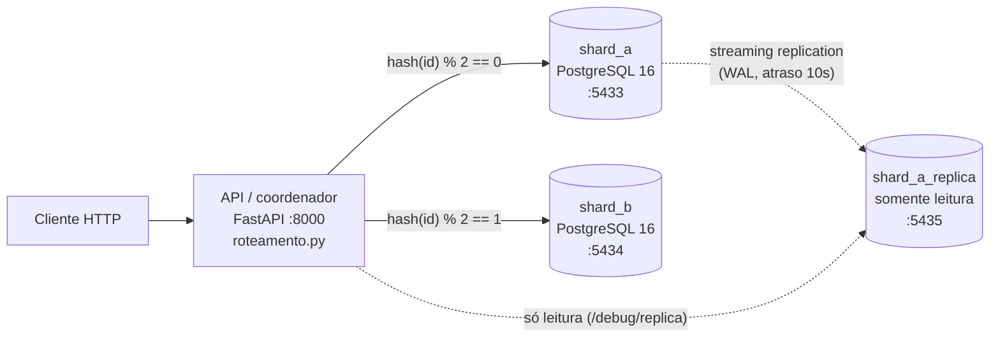

# Loja distribuída de informática (Banco de Dados Distribuídos)

Loja online minimalista de periféricos e hardware (mouse, teclado, headset, fone,
monitor, PC, memória RAM) usada para demonstrar na prática **arquiteturas
distribuídas, fragmentação, replicação, consultas distribuídas e 2PC**.
Tudo roda localmente com Docker, sem custo.

| Fase | Tema | Status |
|---|---|---|
| 1 | Arquitetura base (2 shards + coordenador, `/health`) | ✅ |
| 2 | Fragmentação e replicação (clientes, hot shard, réplica de leitura) | ✅ |
| 3 | Consultas distribuídas (scatter-gather, pushdown) | ⏳ |
| 4 | Transações distribuídas (2PC) | ⏳ |
| 5 | Painel e fechamento | ⏳ |

---

## Arquitetura



**Shared-nothing:** cada shard é um PostgreSQL independente, com processo,
memória e disco (volume Docker) próprios. Os shards não se conhecem; só o
coordenador sabe que existem dois e onde cada dado está.

### O que mora onde

| Tabela | Estratégia | Regra | Por quê |
|---|---|---|---|
| `produtos` (catálogo) | **Replicação total** | cópia completa nos 2 shards | ~50 linhas, muito lida e quase nunca escrita. Qualquer shard responde sozinho e permite FKs locais. |
| `clientes` | **Fragmentação horizontal** | `hash(cliente_id) % 2` | Divide a carga e o volume entre os nós. |
| `pedidos` | **Fragmentação derivada** (co-localizada) | `hash(cliente_id) % 2` | O pedido fica no shard do cliente: "pedidos do cliente X" é consulta local, sem junção entre shards. |
| `estoque` | **Fragmentação horizontal** | `hash(produto_id) % 2` | Chave diferente da do pedido: um pedido pode precisar baixar estoque em OUTRO shard, o que motiva o 2PC (Fase 4). |

Toda a regra de roteamento está em um único arquivo, que cabe num slide:
[`api/app/roteamento.py`](api/app/roteamento.py).

---

## Decisões de design (e o porquê)

1. **Roteamento num módulo só.** API, seed e testes importam a mesma função.
   Se cada parte calculasse o shard do seu jeito, um cliente poderia ser gravado
   em A e procurado em B.
2. **Hash MD5 em vez de `hash()` do Python.** O `hash()` de string muda a cada
   execução (`PYTHONHASHSEED`) e o de inteiro é a identidade (`hash(7) == 7`),
   o que viraria um simples par/ímpar. MD5 aqui não tem papel de segurança: só
   precisamos de um hash determinístico e bem espalhado.
3. **IDs por sequências intercaladas, não `SERIAL`.** Duas sequências
   independentes gerariam `id=1` nos dois shards. Detalhes na Fase 2, abaixo.
4. **Mesmo DDL nos dois shards.** Fragmentação horizontal: todas as colunas,
   parte das linhas. O banco não sabe que é um fragmento; quem sabe é o coordenador.
5. **`CHECK (quantidade >= 0)` no estoque.** Última linha de defesa: mesmo que
   o coordenador erre, o banco recusa estoque negativo (usado na Fase 4).
6. **1 pedido = 1 produto.** Simplificação didática: cada pedido envolve no
   máximo 2 shards (o do cliente e o do estoque), deixando o 2PC legível.
7. **Seed em Python, não em SQL.** A distribuição precisa seguir exatamente a
   regra de `roteamento.py`. É determinístico (`random.Random(42)`), então os
   números dos slides se repetem. Usa `COPY` (carga em massa) para aguentar os
   200 mil pedidos da Fase 3. As categorias têm popularidades diferentes
   (mouse vende 10× mais que PC), o que importará no "hot shard" da Fase 2.
8. **Conexão nova por operação, sem pool, com `connect_timeout=2s`.** Código
   óbvio e um shard que volta é percebido na hora. O timeout impede que um shard
   "pendurado" trave a API inteira.
9. **`/health` fala a língua do negócio.** Além de online/offline, diz o que
   ficou indisponível: quais clientes e **quais produtos** estão sem estoque
   acessível. Isso só é possível porque o catálogo é replicado: o coordenador lê
   a lista de produtos no shard que sobrou e aplica a função de roteamento.
10. **`depends_on` só vale na subida.** A API espera os shards ficarem saudáveis
    para iniciar, mas depois não morre se um deles cair: continua atendendo o
    que puder e reporta o resto (disponibilidade parcial).
11. **Healthcheck com `pg_isready -h 127.0.0.1`.** Durante a inicialização
    (quando roda o `schema.sql`) o Postgres só escuta no socket local; via TCP
    ele só aparece pronto depois do init, evitando que o seed rode cedo demais.

---

## Como rodar

Pré-requisito: Docker com Docker Compose.

```bash
docker compose up -d --build
```

Isso sobe `shard_a`, `shard_b`, roda o `seed` (uma vez; se já houver dados, ele
não faz nada) e sobe a `api` em http://localhost:8000.

```bash
curl -s localhost:8000/health
```

```bash
curl -s localhost:8000/produtos
```

Documentação interativa (Swagger): http://localhost:8000/docs

Recriar os dados (ex.: volume maior):

```bash
docker compose run --rm seed python -m scripts.seed --reset --pedidos 20000
```

Apagar tudo, inclusive os volumes:

```bash
docker compose down -v
```

### Testes

```bash
docker compose exec api pytest -v
```

- `test_roteamento.py`: determinismo, equilíbrio (~50/50) e que o hash não é só par/ímpar.
- `test_health.py`: integração com os shards reais. A queda de um shard é
  simulada apontando o endereço dele para uma porta onde nada escuta (mesmo
  efeito de um `docker stop` para a API).
- `test_clientes.py`: cliente gravado só no shard do hash, ids únicos e ímpares,
  failover do gerador de ids, 503 com shard fora.
- `test_distribuicao.py`: partes somam o todo; a chave categoria desequilibra (>1,5×).
- `test_replica.py`: réplica recusa escrita; mostra dado velho e converge
  (este teste espera ~10 s, o atraso da réplica).

Os testes apagam os clientes que criam e restauram o que alteram.

---

## Validação manual da Fase 1

**1. Tudo de pé:**

```bash
curl -s localhost:8000/health
```

→ `"status": "ok"`, os dois shards `online: true` com latência.

**2. Conferir a distribuição direto nos bancos:**

```bash
docker exec shard_a psql -U loja -d loja -c "SELECT (SELECT count(*) FROM produtos) produtos, (SELECT count(*) FROM estoque) estoque, (SELECT count(*) FROM clientes) clientes, (SELECT count(*) FROM pedidos) pedidos"
```

Repita com `shard_b`. Esperado: `produtos = 50` nos dois (replicado); estoque,
clientes e pedidos divididos (~26/24, ~997/1003, ~1009/991).

**3. Derrubar um shard:**

```bash
docker stop shard_b
```

```bash
curl -s localhost:8000/health
```

→ HTTP 200, `"status": "degradado"`, `shard_b.online: false` e o bloco
`indisponivel.shard_b` com:
- `clientes_e_pedidos`: "clientes com hash(cliente_id) % 2 == 1 e todos os pedidos deles";
- `estoque_inacessivel`: a lista exata de produtos cujo estoque mora no shard_b.

`continua_disponivel` mostra que o catálogo segue no ar (réplica em shard_a).

**4. Derrubar o OUTRO shard e ver o failover do catálogo:**

```bash
docker start shard_b && docker stop shard_a
```

```bash
curl -s localhost:8000/produtos
```

→ `"lido_de": "shard_b"`: a réplica assumiu a leitura.

**5. Tudo fora:** `docker stop shard_b` → `/health` responde **HTTP 503**
(`fora_do_ar`), mas a API em si continua viva para dizer isso.

**6. Voltar ao normal:**

```bash
docker start shard_a shard_b
```

→ `/health` volta a `ok` sem reiniciar a API (conexão nova por requisição).

---

## Fase 2: fragmentação e replicação na prática

### Endpoints novos

| Método e rota | O que faz | Shards tocados |
|---|---|---|
| `POST /clientes` | cria cliente (gera id, roteia, grava) | 1 para o id + 1 para gravar |
| `GET /clientes/{id}` | lê um cliente | 1 |
| `PATCH /clientes/{id}` | altera nome/email/cidade (usado na demo da réplica) | 1 |
| `GET /clientes/{id}/pedidos` | pedidos do cliente, com nome e categoria do produto | 1 |
| `GET /debug/distribuicao` | linhas por shard, tabela a tabela, com % e razão maior/menor | todos + réplica |
| `GET /debug/simular-chave?chave=categoria` | modo experimental: e se a chave fosse a categoria? | todos |
| `GET /debug/replica` | estado da replicação (visto do primário e da réplica) | shard_a + réplica |
| `GET /debug/replica/clientes/{id}` | o mesmo cliente lido no primário e na réplica | shard_a + réplica |

O padrão de todo endpoint de cliente é: **`roteamento.py` diz o shard → o
coordenador conversa só com aquele shard.** Nenhuma operação de cliente toca
no outro shard; é isso que faz a fragmentação escalar.

`GET /clientes/{id}/pedidos` é uma consulta **100% local** graças a duas
decisões: pedidos co-localizados com o cliente e catálogo replicado (o `JOIN`
com `produtos` acontece dentro do shard).

### Geração de IDs: sequências intercaladas ("ticket servers")

Cada shard tem a sua sequência com `INCREMENT BY 2`, começando em restos
diferentes (o seed configura, logo após o último id usado):

```
shard_a: 2001, 2003, 2005, ...   (ímpares)
shard_b: 2002, 2004, 2006, ...   (pares)
```

- Os conjuntos nunca se cruzam: **ids únicos sem nenhum serviço central** e
  sem os shards conversarem. É o esquema que o Flickr usou ("ticket servers").
- **Quem gera o id não é quem guarda o cliente.** O id sai do primeiro shard
  disponível; depois o hash do id decide onde o cliente mora. Assim o equilíbrio
  continua sendo dado pelo hash. Ex.: id 2001 foi gerado pelo shard_a, mas o
  cliente mora no shard_b.
- **Failover:** se o shard_a cair, o shard_b continua gerando ids (pares).
- `nextval()` não é transacional: se o `INSERT` falhar, o número se perde.
  Buracos na numeração são normais e inofensivos.
- Código: [`api/app/ids.py`](api/app/ids.py).

### Modo experimental: chave de fragmentação = categoria (hot shard)

`GET /debug/simular-chave?chave=categoria` pega os pedidos **reais** e
recalcula onde cada um moraria se a chave fosse `hash(categoria) % 2`. Nada é
movido: re-fragmentar uma tabela de verdade (reshard) é caro, e é justamente
o que se evita escolhendo bem a chave desde o início. Compare com
`?chave=cliente_id` (a chave atual):

| Chave | shard_a | shard_b | Razão maior/menor | Pedidos longe do cliente |
|---|---|---|---|---|
| `hash(cliente_id)` (atual) | 1009 (50,5%) | 991 (49,5%) | **1,02×** | 0 |
| `hash(categoria)` (experimento) | 1284 (64,2%) | 716 (35,8%) | **1,79×** | 981 (49%) |

Na chave categoria, o shard_a fica com mouse, teclado e headset (as categorias
campeãs de venda) e vira **hot shard**. Por quê:

1. **Cardinalidade baixa:** só 7 valores distintos. Com tão poucos "baldes",
   o hash não consegue equilibrar; e nunca daria para usar mais de 7 shards.
2. **Distribuição enviesada:** mouse vende 10× mais que PC; quem recebe as
   categorias populares recebe a carga.
3. **Quebra a co-localização:** 49% dos pedidos ficariam em shard diferente do
   cliente; "listar pedidos do cliente" passaria a consultar todos os shards.

**Bônus para o slide ("equilibrado em quê?"):** em **receita** a situação se
inverte: o shard_b teria R$ 918 mil contra R$ 373 mil do shard_a, porque fica
com monitores e PCs (poucos pedidos, caros). Uma chave pode equilibrar linhas
e desequilibrar outra coisa (bytes, CPU de relatórios). A métrica de equilíbrio
depende da carga que importa.

### Réplica de leitura: streaming replication **real**

O `shard_a_replica` é um PostgreSQL clonado do shard_a com `pg_basebackup -R`
que recebe o WAL (log de alterações) continuamente. Ele aceita `SELECT` e
recusa escrita (hot standby). Arquivos: [`db/primario-replicacao.sh`](db/primario-replicacao.sh)
(usuário e permissão de replicação no primário) e
[`db/replica-entrypoint.sh`](db/replica-entrypoint.sh) (clone e subida da réplica).

**Sobre o atraso de 10 s:** numa rede local a replicação leva milissegundos,
rápido demais para ver a olho nu. Usamos `recovery_min_apply_delay = 10s`: a
réplica **recebe** o WAL na hora, mas só **aplica** cada commit 10 s depois. Não é
simulação: é um recurso do PostgreSQL ("delayed standby"), usado em produção
como proteção contra um `DELETE` errado. O valor está em `ATRASO_REPLICA` no
`docker-compose.yml`.

Lição: ler da réplica alivia o primário (escala leitura), mas a leitura é
**eventualmente consistente**. Quem acabou de escrever pode não ver a própria
escrita se ler da réplica (falta de *read-your-writes*). Por isso a réplica
fica fora do roteamento normal; só é lida onde pedimos explicitamente.

### Decisões da Fase 2 (e o porquê)

- **Simulação em vez de mover dados** no experimento da categoria: os números
  são os mesmos e o banco não fica num estado estranho para as próximas fases.
- **Réplica só do shard_a:** uma basta para a demo; replicar o shard_b seria
  copiar e colar o serviço.
- **`/health` mostra a réplica, mas ela não entra no status:** a loja funciona
  sem a réplica; só a demo dela fica indisponível.
- **`wal_keep_size=512MB` no shard_a:** se a réplica ficar parada um tempo, o
  primário guarda WAL suficiente para ela alcançar sem precisar ser recriada.
- **`HTTPException 503` com mensagem clara** quando o shard do cliente está
  fora (`shards.conectar_ou_503`), em vez de um erro 500 genérico.

### Validação manual da Fase 2

Se você vem da Fase 1, recrie os volumes (o schema ganhou as sequências e o
shard_a ganhou a configuração de replicação):

```bash
docker compose down -v
```

```bash
docker compose up -d --build
```

**1. Criar clientes e ver o roteamento:**

```bash
curl -s -X POST localhost:8000/clientes -H 'content-type: application/json' -d '{"nome":"Maria","email":"maria@ex.com","cidade":"Recife"}'
```

→ `"id": 2001`, `"id_gerado_por": "shard_a"`, `"shard": "shard_b"` (gerou num,
mora no outro). Repita algumas vezes: ids ímpares, shards variando conforme o hash.

**2. Failover do gerador de ids:**

```bash
docker stop shard_a
```

Crie clientes de novo: agora `id_gerado_por` é `shard_b` e os ids são pares.
Quando o hash do id apontar para o shard_a (fora), a resposta é **503**
explicando por quê. Depois: `docker start shard_a`.

**3. Pedidos de um cliente (consulta local):**

```bash
curl -s localhost:8000/clientes/226/pedidos
```

→ `"shard": "shard_a"`, 5 pedidos com nome e categoria do produto.

**4. Distribuição real:**

```bash
curl -s localhost:8000/debug/distribuicao
```

→ produtos 50/50 (replicado); estoque, clientes e pedidos ~50% cada; a réplica
com os mesmos números do shard_a.

**5. Hot shard:**

```bash
curl -s 'localhost:8000/debug/simular-chave?chave=categoria'
```

```bash
curl -s 'localhost:8000/debug/simular-chave?chave=cliente_id'
```

→ 64,2% × 35,8% contra 50,5% × 49,5%, e o campo `conclusao` resume.

**6. Dado desatualizado na réplica** (rode os dois comandos em menos de 10 s):

```bash
curl -s -X PATCH localhost:8000/clientes/1 -H 'content-type: application/json' -d '{"cidade":"Manaus"}'
```

```bash
curl -s localhost:8000/debug/replica/clientes/1
```

→ `"primario": {... "cidade": "Manaus"}`, `"replica": {... "cidade": "Curitiba"}`,
`"desatualizado": true`. Espere 10 s e repita: `"desatualizado": false`.
Enquanto isso, `GET /debug/replica` mostra `replay_lag` ~10 s e os bytes de WAL
recebidos e ainda não aplicados.

**7. A réplica recusa escrita:**

```bash
docker exec shard_a_replica psql -U loja -d loja -c "UPDATE clientes SET cidade='X' WHERE id=1"
```

→ `ERROR: cannot execute UPDATE in a read-only transaction`.

Para voltar os dados ao estado do seed: `docker compose run --rm seed python -m scripts.seed --reset`.

---

## Estrutura de pastas

```
docker-compose.yml        shard_a, shard_b, shard_a_replica, seed (one-shot), api
db/schema.sql             DDL de um shard (igual nos dois)
db/primario-replicacao.sh libera replicação no shard_a (1º boot)
db/replica-entrypoint.sh  clona o shard_a e sobe a réplica
api/
  Dockerfile, requirements.txt, pytest.ini
  app/roteamento.py       regra de fragmentação (o slide)
  app/ids.py              geração de ids sem serviço central
  app/shards.py           endereços e conexão com os shards e a réplica
  app/main.py             coordenador FastAPI: /health, /produtos, /clientes
  app/debug.py            /debug/distribuicao, /debug/simular-chave, /debug/replica
  scripts/seed.py         gera e distribui os dados fictícios
  tests/                  pytest
```

## Limitações conhecidas (para discutir no seminário)

- **`hash % N` não escala bem:** ao adicionar um 3º shard, ~2/3 das chaves
  mudam de lugar. Sistemas como o DynamoDB usam *consistent hashing* para mover
  só ~1/N das chaves.
- **O coordenador é ponto único de falha** nesta versão (uma instância só).
  Ele não tem estado, então poderia ser replicado atrás de um balanceador.
- **Réplica sem failover automático:** se o shard_a cair, a réplica não é
  promovida a primário sozinha (seria `pg_promote()` + um orquestrador, como
  Patroni, ou o que o Aurora faz por baixo).
- **O seed não é atômico entre shards:** cada shard é uma transação separada.
  Atomicidade entre shards é exatamente o assunto do 2PC (Fase 4).
