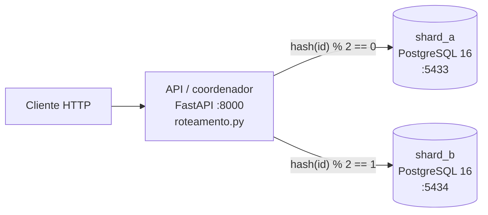

# Loja distribuída de informática (Banco de Dados Distribuídos)

Loja online minimalista de periféricos e hardware (mouse, teclado, headset, fone,
monitor, PC, memória RAM) usada para demonstrar na prática **arquiteturas
distribuídas, fragmentação, replicação, consultas distribuídas e 2PC**.
Tudo roda localmente com Docker, sem custo.

| Fase | Tema | Status |
|---|---|---|
| 1 | Arquitetura base (2 shards + coordenador, `/health`) | ✅ |
| 2 | Fragmentação e replicação | ⏳ |
| 3 | Consultas distribuídas (scatter-gather, pushdown) | ⏳ |
| 4 | Transações distribuídas (2PC) | ⏳ |
| 5 | Painel e fechamento | ⏳ |

---

## Arquitetura (Fase 1)



**Shared-nothing:** cada shard é um PostgreSQL independente, com processo,
memória e disco (volume Docker) próprios. Os shards não se conhecem; só o
coordenador sabe que existem dois e onde cada dado está.

### O que mora onde

| Tabela | Estratégia | Regra | Por quê |
|---|---|---|---|
| `produtos` (catálogo) | **Replicação total** | cópia completa nos 2 shards | ~50 linhas, muito lida e quase nunca escrita. Qualquer shard responde sozinho e permite FKs locais. |
| `clientes` | **Fragmentação horizontal** | `hash(cliente_id) % 2` | Divide a carga e o volume entre os nós. |
| `pedidos` | **Fragmentação derivada** (co-localizada) | `hash(cliente_id) % 2` | O pedido fica no shard do cliente: "pedidos do cliente X" é consulta local, sem junção entre shards. |
| `estoque` | **Fragmentação horizontal** | `hash(produto_id) % 2` | Chave diferente da do pedido: um pedido pode precisar baixar estoque em OUTRO shard, o que motiva o 2PC (Fase 4). |

Toda a regra de roteamento está em um único arquivo, que cabe num slide:
[`api/app/roteamento.py`](api/app/roteamento.py).

---

## Decisões de design (e o porquê)

1. **Roteamento num módulo só.** API, seed e testes importam a mesma função.
   Se cada parte calculasse o shard do seu jeito, um cliente poderia ser gravado
   em A e procurado em B.
2. **Hash MD5 em vez de `hash()` do Python.** O `hash()` de string muda a cada
   execução (`PYTHONHASHSEED`) e o de inteiro é a identidade (`hash(7) == 7`),
   o que viraria um simples par/ímpar. MD5 aqui não tem papel de segurança: só
   precisamos de um hash determinístico e bem espalhado.
3. **IDs atribuídos pelo coordenador, não `SERIAL`.** Duas sequências
   independentes gerariam `id=1` nos dois shards. Na Fase 1 o seed usa ids
   1..N; a geração de ids para clientes novos é decidida na Fase 2.
4. **Mesmo DDL nos dois shards.** Fragmentação horizontal: todas as colunas,
   parte das linhas. O banco não sabe que é um fragmento; quem sabe é o coordenador.
5. **`CHECK (quantidade >= 0)` no estoque.** Última linha de defesa: mesmo que
   o coordenador erre, o banco recusa estoque negativo (usado na Fase 4).
6. **1 pedido = 1 produto.** Simplificação didática: cada pedido envolve no
   máximo 2 shards (o do cliente e o do estoque), deixando o 2PC legível.
7. **Seed em Python, não em SQL.** A distribuição precisa seguir exatamente a
   regra de `roteamento.py`. É determinístico (`random.Random(42)`), então os
   números dos slides se repetem. Usa `COPY` (carga em massa) para aguentar os
   200 mil pedidos da Fase 3. As categorias têm popularidades diferentes
   (mouse vende 10× mais que PC), o que importará no "hot shard" da Fase 2.
8. **Conexão nova por operação, sem pool, com `connect_timeout=2s`.** Código
   óbvio e um shard que volta é percebido na hora. O timeout impede que um shard
   "pendurado" trave a API inteira.
9. **`/health` fala a língua do negócio.** Além de online/offline, diz o que
   ficou indisponível: quais clientes e **quais produtos** estão sem estoque
   acessível. Isso só é possível porque o catálogo é replicado: o coordenador lê
   a lista de produtos no shard que sobrou e aplica a função de roteamento.
10. **`depends_on` só vale na subida.** A API espera os shards ficarem saudáveis
    para iniciar, mas depois não morre se um deles cair: continua atendendo o
    que puder e reporta o resto (disponibilidade parcial).
11. **Healthcheck com `pg_isready -h 127.0.0.1`.** Durante a inicialização
    (quando roda o `schema.sql`) o Postgres só escuta no socket local; via TCP
    ele só aparece pronto depois do init, evitando que o seed rode cedo demais.

---

## Como rodar

Pré-requisito: Docker com Docker Compose.

```bash
docker compose up -d --build
```

Isso sobe `shard_a`, `shard_b`, roda o `seed` (uma vez; se já houver dados, ele
não faz nada) e sobe a `api` em http://localhost:8000.

```bash
curl -s localhost:8000/health
```

```bash
curl -s localhost:8000/produtos
```

Documentação interativa (Swagger): http://localhost:8000/docs

Recriar os dados (ex.: volume maior):

```bash
docker compose run --rm seed python -m scripts.seed --reset --pedidos 20000
```

Apagar tudo, inclusive os volumes:

```bash
docker compose down -v
```

### Testes

```bash
docker compose exec api pytest -v
```

- `test_roteamento.py`: determinismo, equilíbrio (~50/50) e que o hash não é só par/ímpar.
- `test_health.py`: integração com os shards reais. A queda de um shard é
  simulada apontando o endereço dele para uma porta onde nada escuta (mesmo
  efeito de um `docker stop` para a API).

---

## Validação manual da Fase 1

**1. Tudo de pé:**

```bash
curl -s localhost:8000/health
```

→ `"status": "ok"`, os dois shards `online: true` com latência.

**2. Conferir a distribuição direto nos bancos:**

```bash
docker exec shard_a psql -U loja -d loja -c "SELECT (SELECT count(*) FROM produtos) produtos, (SELECT count(*) FROM estoque) estoque, (SELECT count(*) FROM clientes) clientes, (SELECT count(*) FROM pedidos) pedidos"
```

Repita com `shard_b`. Esperado: `produtos = 50` nos dois (replicado); estoque,
clientes e pedidos divididos (~26/24, ~997/1003, ~1009/991).

**3. Derrubar um shard:**

```bash
docker stop shard_b
```

```bash
curl -s localhost:8000/health
```

→ HTTP 200, `"status": "degradado"`, `shard_b.online: false` e o bloco
`indisponivel.shard_b` com:
- `clientes_e_pedidos`: "clientes com hash(cliente_id) % 2 == 1 e todos os pedidos deles";
- `estoque_inacessivel`: a lista exata de produtos cujo estoque mora no shard_b.

`continua_disponivel` mostra que o catálogo segue no ar (réplica em shard_a).

**4. Derrubar o OUTRO shard e ver o failover do catálogo:**

```bash
docker start shard_b && docker stop shard_a
```

```bash
curl -s localhost:8000/produtos
```

→ `"lido_de": "shard_b"`: a réplica assumiu a leitura.

**5. Tudo fora:** `docker stop shard_b` → `/health` responde **HTTP 503**
(`fora_do_ar`), mas a API em si continua viva para dizer isso.

**6. Voltar ao normal:**

```bash
docker start shard_a shard_b
```

→ `/health` volta a `ok` sem reiniciar a API (conexão nova por requisição).

---

## Estrutura de pastas

```
docker-compose.yml        shard_a, shard_b, seed (one-shot), api
db/schema.sql             DDL de um shard (igual nos dois)
api/
  Dockerfile, requirements.txt, pytest.ini
  app/roteamento.py       regra de fragmentação (o slide)
  app/shards.py           endereços e conexão com os shards
  app/main.py             coordenador FastAPI: /health, /produtos
  scripts/seed.py         gera e distribui os dados fictícios
  tests/                  pytest
```

## Limitações conhecidas (para discutir no seminário)

- **`hash % N` não escala bem:** ao adicionar um 3º shard, ~2/3 das chaves
  mudam de lugar. Sistemas como o DynamoDB usam *consistent hashing* para mover
  só ~1/N das chaves.
- **O coordenador é ponto único de falha** nesta versão (uma instância só).
  Ele não tem estado, então poderia ser replicado atrás de um balanceador.
- **O seed não é atômico entre shards:** cada shard é uma transação separada.
  Atomicidade entre shards é exatamente o assunto do 2PC (Fase 4).
